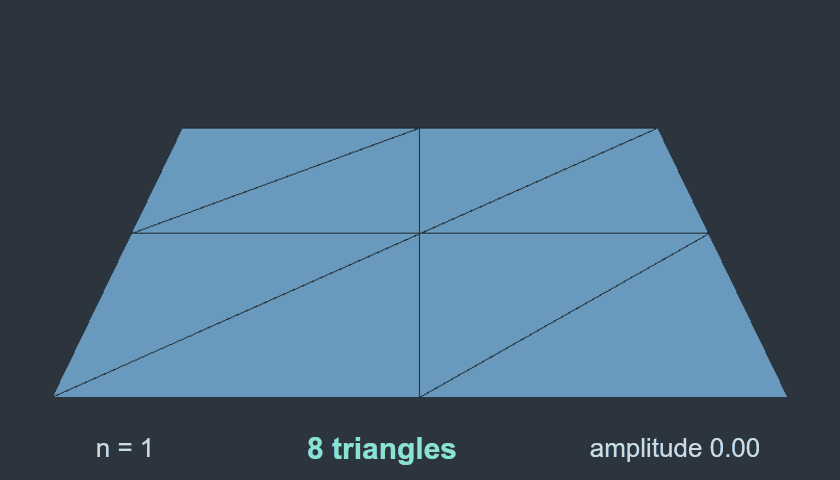
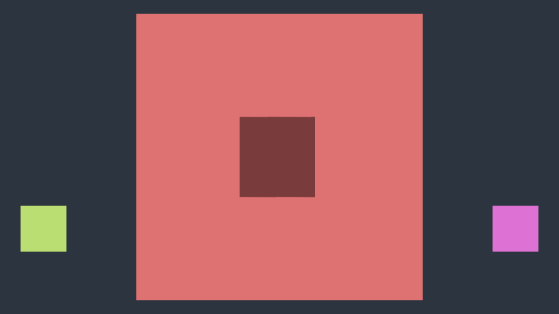

# Adaptive Cluster Rendering

University of Pennsylvania · CIS 5650 GPU Programming and Architecture · Fall 2026 · Group 16

A C++/Vulkan renderer that draws meshes in clusters, adds surface detail on the GPU, and renders directional shadows.

## Milestone 2 on `main`

| GPU subdivision and displacement · Part 2 | Directional shadows · Part 3 |
| --- | --- |
|  |  |
| Subdivision takes the grid from 8 to 32 to 128 triangles. Height-map displacement then raises the mound at 128 triangles. | Filtering casters from the light’s view reduces shadow-pass triangles from 32 to 16 in this scene. The off-camera object still casts the central shadow. |

- **Geometry storage.** The CPU groups Suzanne’s 3,936 triangles into 117 clusters. ACR v2 stores multiple mesh levels, cluster bounds and parent/child links. The viewer can switch between stored levels after one GPU upload.
- **Rendering and measurement.** Both camera and shadow passes draw displaced geometry. The viewer exposes wireframe, camera depth, light depth, triangle counts and per-pass GPU timings. [M2 verification](docs/milestone-2-acceptance.md) · [Recorded measurements](docs/milestone-2-part2-performance.md)

**Automatic level of detail (LOD) is on the Part 1 branch, pending merge.** It builds coarser levels using quadric error metrics and selects detail per region on the GPU using screen-space error. OBJ imports on `main` use a single level. [MeshBuild_and_LOD](https://github.com/JagerCG/AdaptiveClusterRendering/tree/MeshBuild_and_LOD)

## Try the demos on Windows

Install Visual Studio 2022 with Desktop development with C++, Git, CMake 3.24+, and the Vulkan SDK with `glslc`. Use a Vulkan 1.2-capable GPU and driver. Run from the repository root in PowerShell.

```powershell
cmake --preset windows-vs2022
cmake --build --preset release
ctest --test-dir build -C Release -R scene-stored-levels  # Optional two-level ACR sample
.\build\Release\AdaptiveClusterRendering.exe
```

1. **Clusters and storage.** On Suzanne, enable **Cluster colors** and drag to orbit. In **Scene**, try **Save + verify ACR...** and **Reload saved ACR**. To compare two levels, open `build/test-data/hierarchy/hierarchy.acr` with **Open OBJ / ACR...** and switch **Stored ACR geometry levels**.
2. **Blue mound.** Choose **Scene → Demo scene → Blue mound**. In **Surface**, turn off **Height displacement**. Enable **Wireframe**, try 1, 2 and 4 segments per edge, then turn displacement back on.
3. **Off-camera shadow.** Choose **Scene → Open view...** and open `assets/views/m2-shadow-casters.acrview`. In **Shadows**, toggle **Cull casters in light view** and watch **Shadow triangles**. Select **Shadow map (light view)** to inspect the light’s depth.

## Remaining work

- **Milestone 3.** Merge Part 1 and improve boundary and silhouette preservation during simplification. Use the cluster hierarchy, camera frustum and hierarchical depth (Hi-Z) to cull geometry before subdivision and drawing. Check displaced bounds and off-camera shadows on larger meshes.
- **Final submission.** Profile and optimize against a full-detail baseline at fixed viewpoints. Publish matched images, cluster and triangle counts, CPU/GPU timings and limitations. Package the tested code, pitch, milestone slides, final presentation and recorded demo.

[Milestone 1 slides](presentations/Milestone1.pptx) · [Detailed demo guide](docs/milestone-2-part2-demo.md)

Built with GLFW, GLM, TinyObjLoader and Dear ImGui. Suzanne by UX3D and Norbert Nopper. [Mesh source](https://github.com/KhronosGroup/glTF-Sample-Assets/tree/main/Models/Suzanne) · [CC0 1.0](https://creativecommons.org/publicdomain/zero/1.0/)
